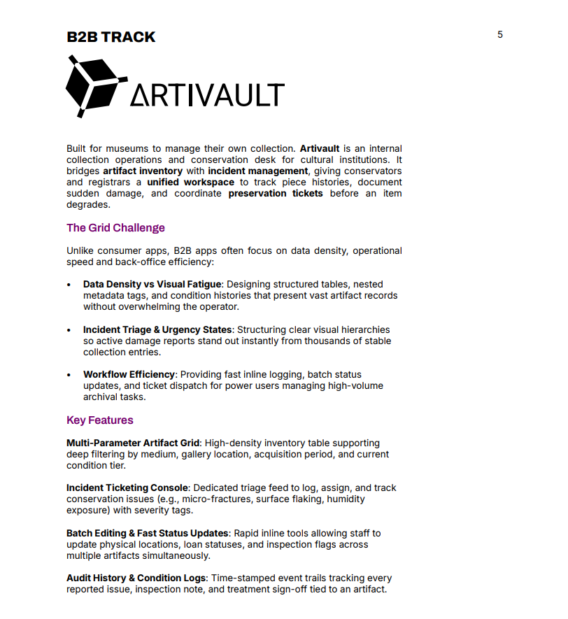
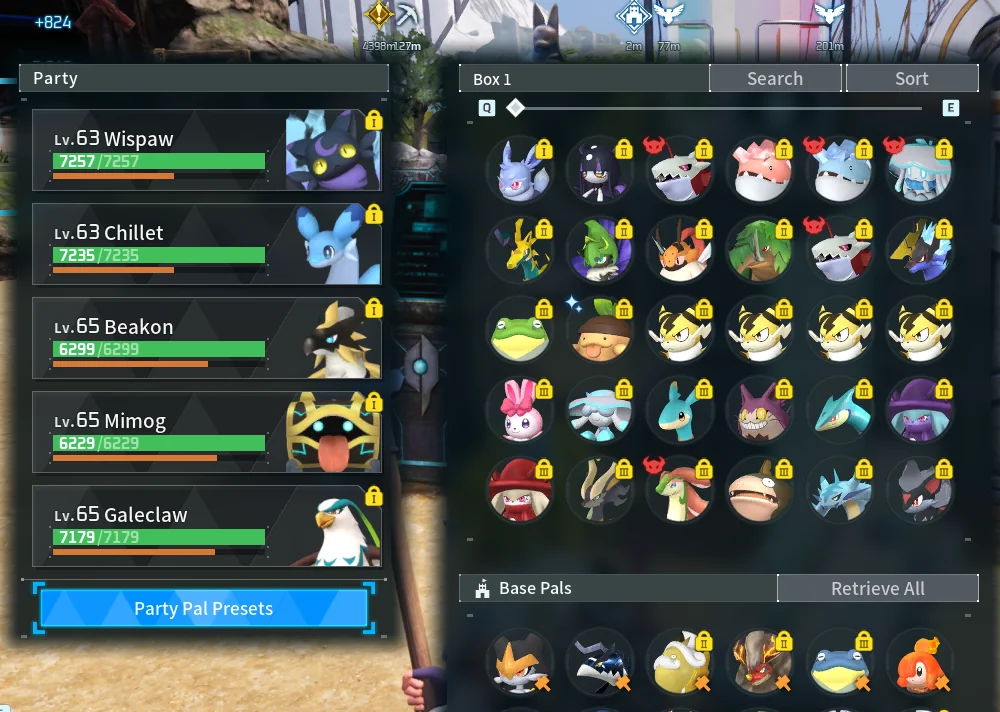

Topic Selection : Production Project : ARTIVAULT (B2B)

# Preface

- I chose to go with Track 1 being Artivault because it's a design challenge I've never faced in the passed before. I mainly specialized in Business to Customer challenges in the past and I'm taking this opportunity to create a Business to Business design. By doing so I'm also envisioning this design to contribute to my overall portfolio for future employment. Overall, this choice was made to solely step out of my comfort zone as a designer. 

![B2B_track_Description.png]

## At a Glance Overview from Company's Description Document
##### Keywords: 
			1. Artifact
			2. Inventory 
			3. Incident Management 
			4. Tracking 
			5. Perseveration Tickets

##### Important questions to ask: 
- *What does it mean "Before an item degrades"* : Does it mean the ticket or art
##### Good to remember: 
			1. DO NOT overwhelm the users
			2. Triage is important and hierarchies will influence it
			3. Efficiency matters (i.e. logging, status, updates)

##### Main motivation will be:
			1. Filtering systems:
					a. Medium 
					b. Location 
					c. Time 
					d. Severity tiers
			2. Audit History 
					a. Tracking 
					b. inspection 
			3. Incident Ticketing
					a. Tagging system
					b. Triage system 
					c. Labeling (i.e. legends, colour codes)

# Design Pillars 

1. Usefulness
2. Usability 
3. Findability 
4. Credibility
5. Desirability 
6. Accessibility 
(Source: https://www.orbix.studio/blogs/7-pillars-of-ux-design)

Chosen Design Pillars

<li>  Based off of the project requirements the main pillars (3) that I'll be focusing on for a successful platform for Artivault are: </li>
			<ul> Usefulness: Does the product solve a real problem? </ul>
			<ul> Usability: Can users accomplish goals efficiently? </ul>
			<ul> Findability: Can users locate what they need? </ul>
			<ul> Credibility: Do users trust you product 
			(This last pillar is a subcategory that will also greatly influence the platform's success rate.) </ul>

##### Usefulness
- Make sure a problem is solved 
		*Bridging inventory and incidents from Artivault?*
		*Why is this better than SalesForce? Source: https://www.salesforce.com/ca/
		(The concrete written out problem to be solved is still TBD)
- PROVE that the product/design needs to exist
- Validate the users needs FIRST before even considering designing

==Important to note for this pillar:== 
- More features does not mean it's a better platform 
- If a problem is not properly solved it's not a well fleshed out design 

##### Usability
- Keep in mind these key elements: 
		a. Learnability: How easy
		b. Efficiency: Speed
		c. Memorability/familiarity!
- User flow MATTERS

==Important to note for this pillar:== 
- How to make platform satisfying: How to make it pleasant?

##### Findability
- Verify these elements: 
		a. Ask users to sort out categories 
		b. Figure out mental thought process 
		c. Do text only versions to test structure + flow

==Important to note for this pillar:== 
- User testing is going to be the most efficient way to judge findability

##### *Credibility* (To be seriously considered)
- Create specific markers 
- Ways to create trust with the users 
		a. Consistency makes a platform more credible 
		b. Professional visual design 
		c. Modern look 
		d. Contact/help/information page 
		e. Training page
- Can add *?* page 
- Can add *About* page
- Can add *FAQ* page
- Can create fictional social media pages for future potential (i.e. Linkedin, Instagram)

# Problem Space and Objectives 

- Artists and/or museum managers trying to monitor their pieces in art spaces. 
		a. Ticketing based platforms can be overwhelming already and confusing to use
		b. All users may not have the same amount of tech-savvy knowledge

# Specifications

##### Question
1. *How can we create a platform that helps Artivault be able to manage incidents within art inventory?*
2. *How to make a platform that tracks history, damage control and that coordinates persevation tickets?*
##### Themes
- Damage reports;
- Large data sets;
- Logging; 
- Ticketing;
- Grids;
- Art;
- Hierarchies;
- Tagging. 

##### Goal
Create a clear and user-friendly platform that helps museums manage their collections based on the condition and status of each piece. The goal is to present information simply without overwhelming users, while maintaining a visually engaging design that feels less corporate. The platform should be accessible to users with different levels of technical experience.

*Aesthetics will be considered a sub-goal for this project. If I'm able to make a ticketing platform that is also beautiful it would definitely stand out from current existing ones, especially since Artivault is mainly ran by creatives.* 

# Research

What Already Exists: 
1. **SalesForce** https://www.salesforce.com/ca/ 

Why does it work well?  

	- Automates routing; 
	- Uses AI to categorize, prioritize and resolve; 
	-  Omnichannel: works with email, chat;
	- Option for customers to send photos, videos and audio not just text;
	- Integrates with other tools: Slack real-time collab.  

Why it doesn't work well?  

	- Clunky user experience;
	- Non-intuitive layout;
	- Really expensive;
	- Need extra tools to make it work sometimes;
	- Complicated: too much customization and messy configurations.

2. **Zoho** https://www.zoho.com/  

Why does it work well?  

	- Users can merge, clone and split tickets;
	- Self service capabilities;
	- Omnichannel;
	- Dashboard customization: customers can design personalized dashboards;
	-  Multilingual help desk;
	- Integrates with other tools: Can be enhanced with ChatGpt. 

Why it doesn't work well?  

	-  Inconsistent navigation and workflow; 
	- Doesn't integrate smoothly; 
	- Steep learning curve and clunky UI/NO ICONS;
	- Dated and overwhelming;
	-  Multiple nested settings menus. 

3. **Slack** https://slack.com/  

Why does it work well?  

	- Flexible: internal support, communication and customer support;
	- Collaboration; 
	- Very easy to use;
	- Can be integrated with a lot of CRM, project management tools;
	- Automation is available: Custom bot.

Why it doesn't work well?  

	- Notification overload which increases distractions and decreases productivity; 
	- Buried information in chats;
	- Toxic availability makes people respond immediately; 
	- Lacks structure for some projects 

4. **Zendesk** https://www.zendesk.com/  

Why does it work well?  

	- No code-tools;
	- Automatically assigns tickets to right reps;
	- Prebuilt customizable ticketing workflows;
	- Powerful automations;
	- Integration with other tools: For analytics, reporting, time tracking.  

Why it doesn't work well?  

	- Expensive tiers; 
	- Add-on fees: specific integration, ai features;
	- Clunky interface;
	- ated and disjointed UI: Aging interface doesn't keep up with modern design;
	- Configuration menus deeply buried ;
	- Lengthy setup onboarding takes months and needs a technical specialist;
	- Difficulty customizing data;
	- No direct comment referencing in tickets and can't take notes;
	- Reporting limitations.

# User Assumptions/Data Interpretation
##### Data Interpretation Approach
[[	Persona Map on Figma with a mix of Affinity Diagramming]]
		- Link:   
		[https://www.figma.com/board/d3EpxpeCnAKdIplVabUhBV/EmpathyMaps_498_Artivault?t=lH8eTZCQpcUQHqdf-6](https://www.figma.com/board/d3EpxpeCnAKdIplVabUhBV/EmpathyMaps_498_Artivault?node-id=17-1990&t=s9MU6RfQtC61Ij55-4)

# List of Key Features
##### Features important to test (3)
	1. Damage sorting/severity levels;
	2. Filtering systems for searching artwork;
	3. Personalization keys for case by case situations. 

##### Important to Remember to this date from Artivault Sales, Dev and Product Manager

1. Sales:
		<ul>1. Prospects are asking for a dense master table (overview) where users can view artifact records with custom sorting and filters for medium, location, and acquisition date; </ul>
		<ul> 2. A major museum director is comparing us to legacy software. Their team requires multi-row selection with a header export button to quickly export filtered grid selections as custom PDF sheets or CSV manifests. Staff also need to stack filter rules (e.g., acquisition dates, gallery wings, conservation status) and save these setups as Custom View Presets to avoid rebuilding search queries daily. Like: Acquired 2018-2020 AND Wing B AND Condition: Good </ul>
2. Dev: 
		<ul> 1. Do not think of live auto-refresh! It kills performance. Include a manual refresh button with a 'Last Synced' timestamp in the table header; </ul>
		<ul> 2. Performing batch edits or exports on 5,000 records simultaneously results in browser freezing! Cap row selection at 50 items per operation, and introduce pagination choices (25, 50, or 100 items per view) to prevent rendering entire record sets within the web page. </ul>
3. Product Manager
		<ul> 1. We need an urgent triage feed to log damage tickets with severity tags (Low, Moderate, Critical) so alerts sit clearly apart from normal inventory; </ul>
		<ul> 2. When users select an item from the grid, route them directly into a dedicated artifact detail page. Conservators and registrars need an exhaustive view showing high-resolution imagery, descriptive cataloging data, and related condition logs in one unified layout. </ul>

# List of Detailed Features
##### Links to user flow
[[	User Flow on Figma]]  
		-  Link: https://www.figma.com/board/d3EpxpeCnAKdIplVabUhBV/EmpathyMaps_498_Artivault?node-id=17-1991&t=s9MU6RfQtC61Ij55-4

##### Wireframing Prototype 1 (2026-09-29)  

Link to Prototype 1:   
https://www.figma.com/design/lzBgjmTrpfn34zzNeVUofv/Prototype1_498_Artivault?m=auto&t=e4i1wkqm6nIfcCDF-1  

Focus: 
1. `General view: Search screen, Create Damage Ticket screen, Collection Overview screen;`
2. `Ticketing management: (Critical, Moderate, Low);`
3. `Two users were focused on: Santiago and Bryton.`  

*All icons are placeholders, assets will be thought about at the very last stage due to it being a very low priority for now. Data organization and filtering as well as customisation are the main issues*

Key Factors and Reasoning Behind: 
###### - Searching and filtering have a "personalized preset" option  

 Why?   
 
1. Noticed how users from other ticketing/incident platforms highly dislike having to search for new elements every time;
2. . Following Don Norman's Principles about visibility, users dislike having to redo things or start again. The human brain typically follows the easiest way to do things;
[https://www.heurio.co/don-norman-principles-of-design](https://www.heurio.co/don-norman-principles-of-design)
3.  Personal main inspiration was while playing the video game _Palworld, there's a rotation preset option for the Pals_ in your inventory which I found practical, quick and easy to use.`  
4. Doing this preset save option makes it that every user has to have a personal profile now which ads need for a login page
	
[[presetExample_Palworld.webp]]

###### - "Damage Ticket" page creation  

Why?    

1. Main concern of the project;
2. Encountered in many user flows; 
3. Added a reward system: many ticketing platforms don't reward users or add satisfaction elements. This was added to stand out from other platforms. Also based self off of Don Norman's feedback criterion (shows the users they're getting somewhere).  

###### - "Quick Overview board" page creation  

Why?  

1. Considering managerial positions (User flow: Santiago);
2. Quickly glance at the state of the museums inventory;
3. Users don't have to search for information.

###### - "Urgent Damage Triage" window creation  

Why?    

1. Specific request from product manager;
2. Able to minimize this window to help with information overload; 
3. The window doesn't leave the screen only gets smaller for users to find it easily;
4. Similar to chat boxes on websites so that the users are familiar with the way it works.

###### - "Artifact detail page" window creation  

Why?    

1. When selected from collection overview page the user is directed to the page;
2. Has easy view for log history good and bad of the artifact and separate to filter just the incidents;
3. Quick actions menu that can be done to the detail page for users;
4. Good tagging methods for easily searching the artifact in the collections overview page;
5. Users are allowed to add personal notes;
6. Details and history of artifact available at an easy glance.

# User Form Prototype 1  
##### Motivation behind the form:  
For the feedback form, I wanted to focus on how people understand the prototype visually. Since Artivault is still an early wireframe, I am not testing full functionality yet. I am testing the layout, information hierarchy, labels, and overall organization. The questions focus on the Collection Overview, filters, artifact details, damage tickets, triage, and dashboard. I want to see what feels clear and what feels confusing. I also want to know what users notice first and where they would naturally look for information. The answers will help me find areas that need to be simplified or reorganized before I make the prototype more interactive.  

Link to Google Docs:   

https://docs.google.com/forms/d/e/1FAIpQLSc36mMpYvWD0eGBj9RIcrUQPh6sdHybdJhMJz5y3Qbou6tOgw/viewform?usp=publish-editor

# Colour and Fonts and Aesthetics

New addition from the team:   
"VINCENT - PRODUCT MANAGER We should consider adding a quick preview or side panel to the main page, allowing users to rapidly inspect artifact details prior to accessing the detailed view.   

Clients also want to see color explorations. Begin investigating visual cues and detailed styling on top of the current wireframes. Museum directors are intimidated by dense spreadsheets, so we need visual polish to soften the data load.   

Explore typography scales, subtle row contrast, and a color palette that makes complex artifact logs feel premium and scannable."

##### Prototype 1  
- Important to note: Already started testing colours within the first prototype  
	- I was aiming for neutral and earthy tones to fit with a museum-like aesthetic
	- Also aiming for unisexe-like colour palette
	- Started with 5 colours of for the logo:  
	1. Purple  
	2. Yellow
	3. Baby blue
	4. Light green
	5. Orange
![[Pasted image 20261005170102.png]]
